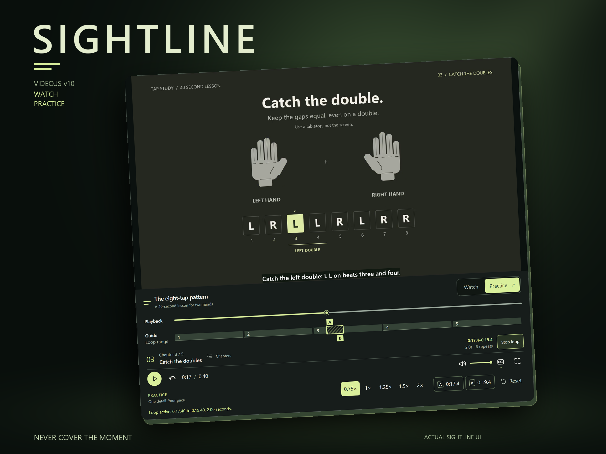
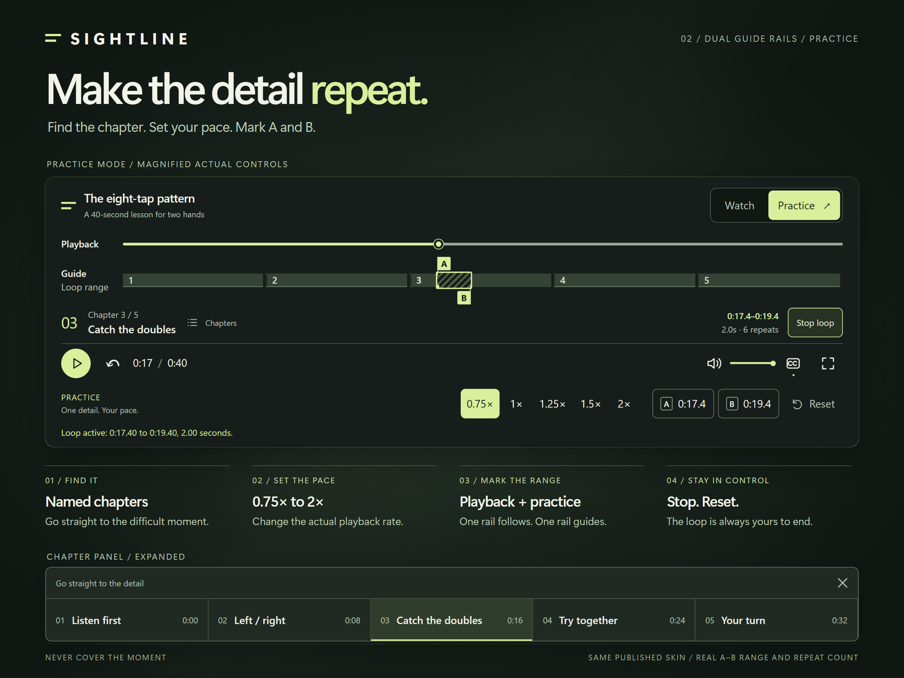
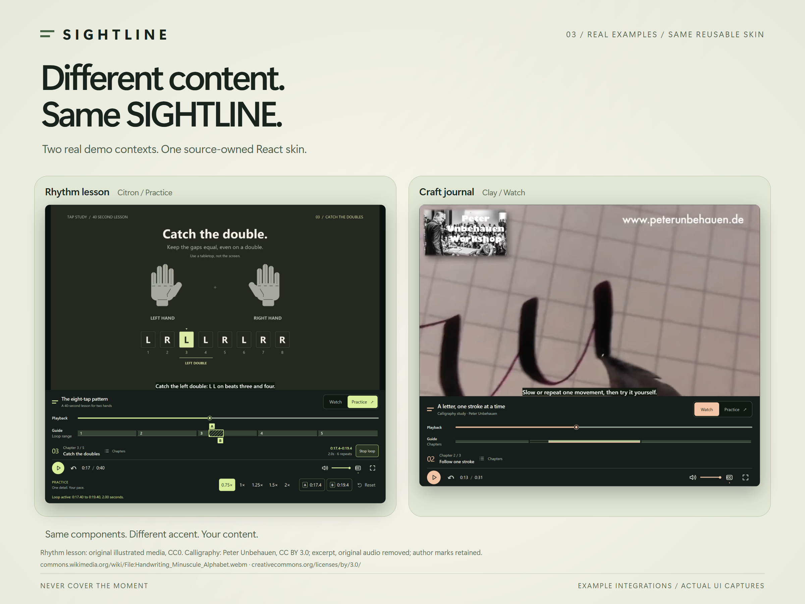
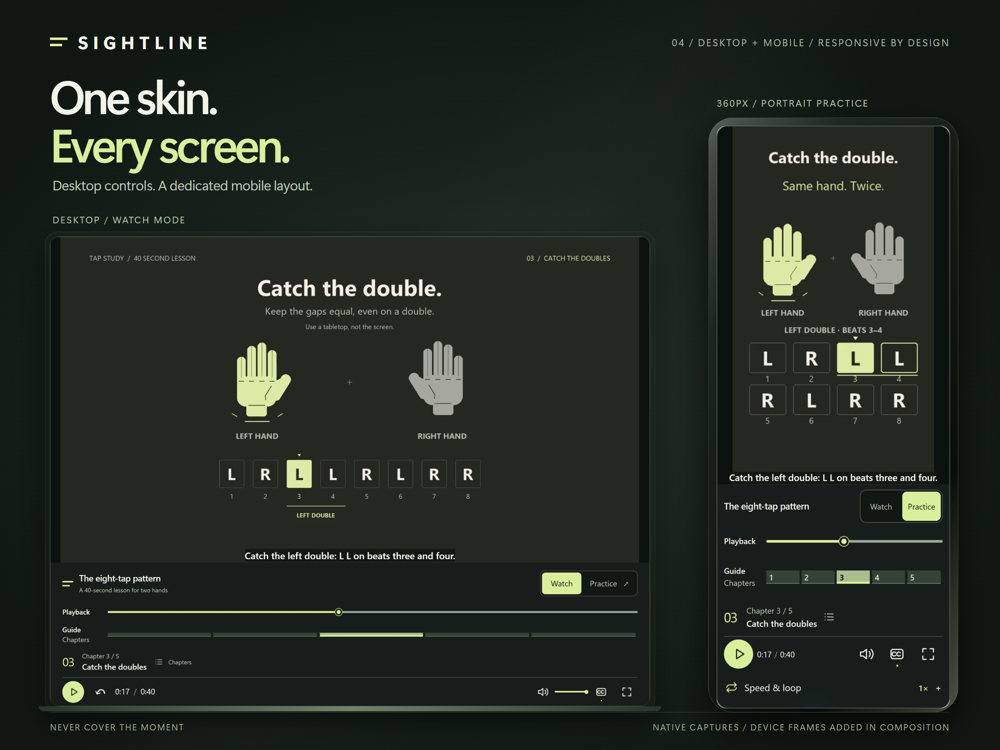

# SIGHTLINE — Never Cover the Moment

*Watch the moment. Master the detail.*

A source-owned Video.js v10 skin for watching and practicing. Playback controls sit below the picture. Watch keeps the essentials close; Practice adds named chapters, direct playback speeds and an exact A–B loop without replacing the media instance.

Playback Rail shows where you are. Guide Rail shows chapters and your active practice range, with labeled A/B points, duration, repeat feedback and an explicit Stop.

- Demo: https://sightline-player.ng-van-hung90.chatgpt.site
- Source: https://github.com/ngvanhung90/sightline-videojs-v10
- Original Challenge entry: https://contra.com/community/UTpczOTl-sightline-video-player-with-practice-controls

## Run

Node24 LTS and the committed lockfile are the development baseline.

```sh
npm ci
npm run dev
npm run typecheck
npm run lint
npm run build
npm run build:workbench
```

## Integrate only six files

Copy these paths into your application's `src/sightline/`, preserving the relative structure:

```text
index.ts
player.ts
video/skin.tsx
video/skin.css
video/icons.tsx
video/use-practice-loop.ts
```

Install `@videojs/react@10.3.0` and `@videojs/core@10.3.0` into an existing supported React 18 or 19 app. Keep the app's React runtime; the minimal skin needs no cn or scaffold helpers.

```tsx
import { I18nProvider } from '@videojs/react/i18n';
import { Video } from '@videojs/react/video';
import { SightlinePlayer, VideoSkin } from './sightline';

export function Film() {
  return (
    <I18nProvider locale="en">
      <SightlinePlayer>
        <VideoSkin title="Your film" sourceKey="film-01">
          <Video src="/film.mp4" playsInline crossOrigin="anonymous">
            <track kind="chapters" src="/chapters.vtt" default />
            <track kind="captions" src="/captions.vtt" srcLang="en" label="English" />
          </Video>
        </VideoSkin>
      </SightlinePlayer>
    </I18nProvider>
  );
}
```

Tracks are optional. WebVTT needs a valid MIME type and cross-origin assets need suitable CORS. Keep provider, skin and media mounted across mode changes; supply a fresh sourceKey when choosing another asset. This is client-side native-video support; other media adapters and SSR/Next hydration are not claimed.

The host must deliver seekable media. For progressive MP4, verify actual HTTP Range responses and native `video.seekable` on a cold cache; a fully buffered file alone does not establish seek support. The demo serves its three principal media assets through Mux Free standard `highest.mp4` renditions, with local VTT and poster files. This is a demo delivery choice, not a Mux dependency of the six-file skin. Public playback IDs are in `apps/demo/media-sources.ts`; no API credentials, analytics or extra media adapter are added. The licensed original MP4s remain in the repository. `?delivery=origin` explicitly selects those retained copies as an origin-delivery regression control. See `apps/demo/public/media/MUX-SOURCES.json` for provenance. Mux Free limits apply; no paid plan or payment method was activated. Native browser acceptance is recorded separately from account setup and HTTP probes.

Set `--media-accent-color`, `--media-accent-text-color`, `--media-border-radius` and `--media-font-family` on the skin. Choose accent/text colors together and test contrast.

## Practice behavior

Choose a chapter, set the real playback rate, then capture A and B from the current native time. B must be at least 0.25 seconds after A, within a currently seekable range. Point values include fractions, and the shared range readout shows duration and repeats. Reset/Stop loop is explicit and returns keyboard focus to the chapter trigger.

A–B requires a finite, seekable, on-demand native Video at least 0.25 seconds long. Live, unknown duration and other adapters keep it disabled. Source/range changes invalidate pending returns. A resolved seek is checked against the intended source and actual position before counting. Automatic returns suppress only their seek announcements; manual playback/rate/volume changes retain Video.js announcements. Actual screen-reader behavior must be tested, not inferred from the DOM.

## Original lesson and demonstration

The new 40-second lesson teaches `L R L L R L R R` as a reproducible tabletop exercise, with original diagrams and synchronized synthesized clicks. Chapter 03 highlights the doubles. The 16–20 second bar is a useful repeat range. The sequence is not claimed as an invention or a certified teaching method. No learning-speed or click-count improvement is claimed without measurement.

The generator is `scripts/generate_lesson.py`. The original render, intermediate WAV/silent videos and provenance are retained separately; only published assets are staged in `apps/demo/public/media/practice`. The illustrated hands, tap sequence diagrams, synthesized clicks and authored VTT are original CC0 work. Hand movement is an instructional illustration, not a recording of a person.

The second example (`?view=workshop`) uses the same skin with a different brand and real pen movement: **Handwriting Minuscule Alphabet**, by **Peter Unbehauen**, licensed [CC BY 3.0](https://creativecommons.org/licenses/by/3.0/), [source on Wikimedia Commons](https://commons.wikimedia.org/wiki/File:Handwriting_Minuscule_Alphabet.webm). Changes: a 32-second excerpt from 00:08, original audio removed, H.264 encode; no tempo change. Original author marks remain visible. This is an example integration, not a client endorsement. Attribution and hash provenance accompany the media in `apps/demo/public/media/handwriting`.

Code is Apache 2.0. The original lesson is CC0; the third-party calligraphy excerpt remains CC BY 3.0. No paid APIs, analytics, backend, external font downloads or user accounts are added.


## Verification and limits

Skin code is locked at `be1359b4fdb8167bbf986571f8a8eaf634b6e3c4`. Any release documentation commit must preserve those six source-file hashes. Clean-clone typecheck, lint, demo and workbench builds passed for that source. Hosted Chromium checks observed actual seek/chapter/rate changes, repeated A–B returns, Stop/Reset, source clearing, mode-state preservation, captions, keyboard and responsive controls. Fullscreen entry/exit was accepted by the Owner through direct use. Touch evidence uses trusted Chrome emulation; it is not a physical-phone test.

Firefox, Safari, screen-reader and physical-phone acceptance have not run. No WCAG certification or measured learning-speed improvement is claimed. Live/unknown-duration looping is guarded in code, but a full real-live-stream acceptance suite has not run. Native MP4 delivery must expose a valid seekable range; see the hosting guidance above.

The90-second product film combines recordings of this working candidate with illustrative Google Flow footage and Tyra narration. Generated scenes are not software evidence. Caption/timestamp, full decode and signal checks passed; full perceptual synchronization acceptance across speakers and headphones is not claimed. The original79-second walkthrough remains available at `/sightline-demo.mp4` for historical links.

Challenge participation, an existing saved entry and final social completion are separate. A saved entry alone is not proof of Completed/Eligible status. Any final completion receipt must come from Contra.


## Product gallery and film

[Watch the90-second product film](https://sightline-player.ng-van-hung90.chatgpt.site/sightline-final-90s.mp4). The player below the picture, Practice controls and device layouts shown here are actual SIGHTLINE captures. Device framing and macro views are editorial composition.









The film reuses illustrative Google Flow shots with mandatory watermarks and the approved Tyra soundtrack. No generated UI is presented as software evidence. Rhythm lesson: original CC0. Calligraphy: Peter Unbehauen, CC BY3.0; excerpt/audio removed, author marks retained. [Source](https://commons.wikimedia.org/wiki/File:Handwriting_Minuscule_Alphabet.webm) · [License](https://creativecommons.org/licenses/by/3.0/).
